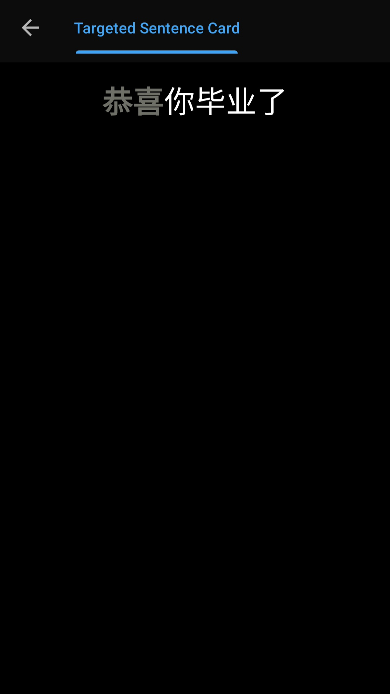
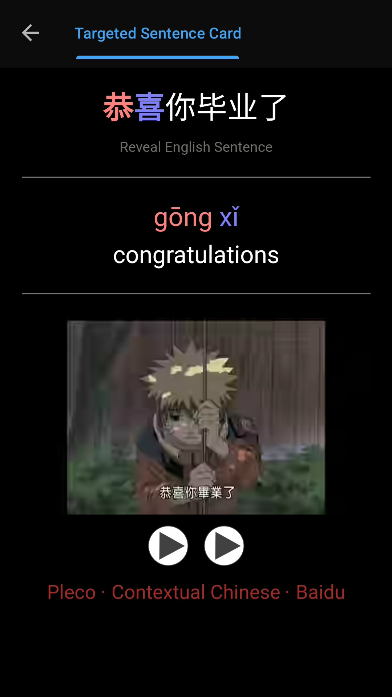

An Anki deck of **10,900 Targeted Sentence Cards** with word and sentence audio.
Can also be downloaded [here](https://github.com/PrinceLumpy/immersion-settings/releases/tag/2.0.0)

## Features

- 💬 **Sentence and translation:** Each card includes the sentence, English translation, and local TTS audio
- 🎨 **Tone color-coding:** When you flip the card, the pinyin and the target word in the sentence are colored by tone, pleco color scheme
- ✍️ **Target word highlighting:** If you bold the target word in `SentHanzi` with `<b>...</b>`, that explicit markup takes precedence. Otherwise, JavaScript looks for exact matches of `VocabHanzi` in the sentence and bolds them.
- 🔗 **Vocabulary lookup links:** Quick links to look up the target vocabulary in Pleco, Contextual Chinese, and Baidu
- 📚 Card format inspired by AJATT: ([read about Targeted Sentence Cards](https://ajatt.top/blog/discussing-various-card-templates.html#targeted-sentence-cards))

## Card Template
Front:

Back:

> 💡 **Tip:** Tap or click the **Reveal English Sentence** hint button to reveal the English translation, or **Note** to reveal your notes.

## Suggested Usage

- **Pair with a grammar guide.** Read through a [grammar guide](https://grammar.ajatt.top/) once, then focus on understanding sentences rather than memorizing rules.
- **Pace yourself.** I recommend learning **5–10 new words a day**.
- **Prioritize sentence mining.** Start sentence mining as soon as possible. Set up [mpvacious](https://github.com/Ajatt-Tools/mpvacious) and [Yomitan](https://yomitan.wiki/) to mine content you choose. This deck supplements your learning with words you may not have encountered in your mining workflow.
- **Recognition only.** This deck is built for recognition, not production. It is designed with Stephen Krashen's input hypothesis in mind. I highly recommend [this video](https://www.youtube.com/watch?v=J_EQDtpYSNM) on why comprehensible input is key.

## 💭 Thoughts on Prebuilt Decks

Prebuilt decks are a good introduction to SRS, but no prebuilt deck contains every word or all of its possible usages. I recommend switching to [Yomitan](https://github.com/yomidevs/yomitan) and [mpvacious](https://github.com/Ajatt-Tools/mpvacious) when possible, to get real native audio and words relevant to your interests.

In the meantime, this deck can supplement your learning when you're away from your sentence-mining setup.

You can also add individual words via Yomitan, or manually from your phone, and backfill the sentence data from this deck using [Copy Anywhere](https://ankiweb.net/shared/info/1530249436). A few matches may contain the target word as part of a longer word.

## 🔊 Audio Note

The `VocabAudio` and `SentAudio` fields are empty in this deck. When either field is empty, the back of the card uses Chinese (`zh_CN`) text-to-speech for the word or sentence. TTS requires downloaded `zh_CN` voice data.

## 🔗 Sources

- [Anki Xiehanzi](https://krmanik.github.io/Anki-xiehanzi/)
- [Batch Sentence Adder](https://ankiweb.net/shared/info/1682655437), used with Tatoeba sentence data to fill in sentences for some cards.
